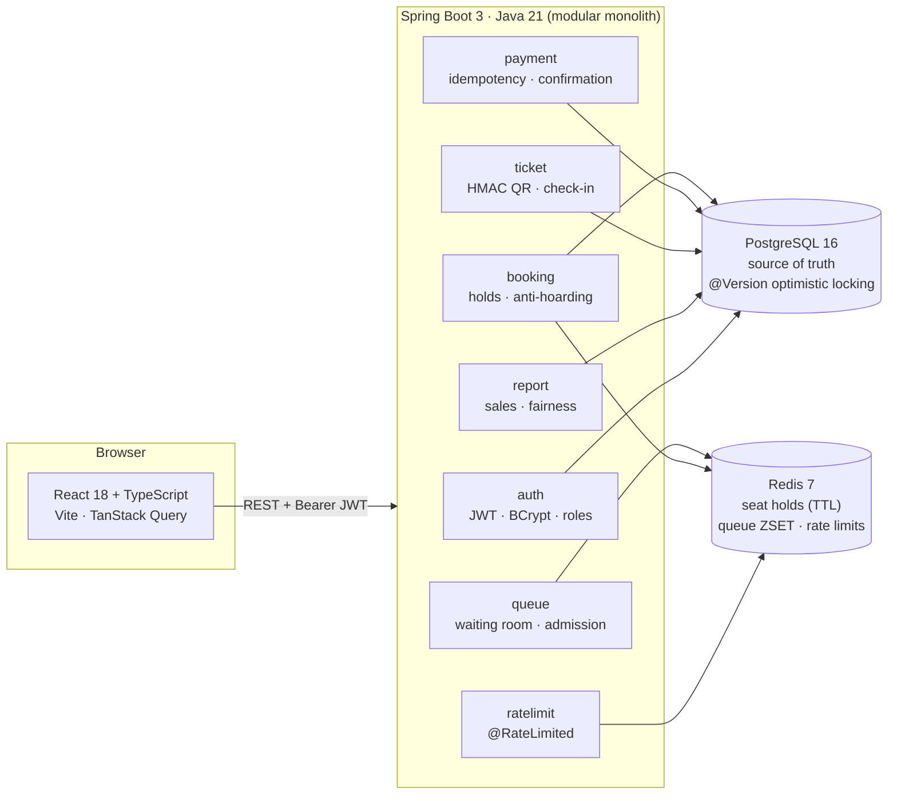

# SeatSure

**Fair ticketing for high-demand event drops.** When thousands of people click at the same second,
most booking sites crash, sell the same seat twice, or quietly reward whoever has the fastest script.
SeatSure is built for that one minute: arrivals go into a virtual waiting room and are let in **in
the order they arrived**, seats are held in Redis with a TTL while you pay, the sale itself is
settled by PostgreSQL optimistic locking, payments are idempotent, and every ticket is an HMAC-signed
QR code that the gate can scan exactly once. A 500-user load test proves no seat is ever sold twice.

---

## Architecture



Postgres is the source of truth; Redis holds only state that is allowed to disappear — a hold, a
place in the queue, a rate-limit counter. Losing Redis costs availability, never correctness.

---

## How double booking is prevented

Three independent layers, each of which would be enough on a good day. All three are there for the
bad day.

**1. Redis holds, taken atomically.** Choosing seats runs one Lua script that does `SET NX EX` for
every seat in the basket. Redis executes a script atomically, so no other request can interleave. If
*any* seat is already held, the script releases the ones it just took and returns the seats that were
lost; the API answers `409` with that exact list, and the user sees *"Someone just grabbed seat B12"*.
All or nothing — a half-held basket never exists. The hold is a key with a 7-minute TTL, not a column,
so an abandoned checkout releases itself with no job to run and no row to reset.

**2. Optimistic locking in Postgres.** Paying re-reads every `event_seat` row and flips it to
`BOOKED` inside one transaction. Each row carries a `@Version`, so the UPDATE becomes
`... WHERE id = ? AND version = ?`. If another transaction committed first, zero rows match,
Hibernate raises an `OptimisticLockException`, the whole transaction rolls back and that user gets a
`409`. No pessimistic row locks are held while a human types their card details.

**3. A partial unique index.** `booking_seat` rows carry a `confirmed` flag, and
`unique (event_seat_id) where confirmed` means the database itself refuses to record one seat in two
confirmed bookings — even if the application code had a bug.

Proven, not asserted:

- `DoubleBookingGuardsTest` exercises layers 2 and 3 directly against real Postgres.
- `SeatBookingConcurrencyTest` throws 50 threads at 10 seats through the real HTTP API and then
  checks in SQL that exactly 10 seats are booked, each in exactly one confirmed booking.
- The k6 run in [`loadtest/RESULTS.md`](loadtest/RESULTS.md): 500 users, 50 seats, **50 sold, 0 sold
  twice**.

---

## How the waiting room works

For an event flagged `high_demand`:

1. **Join.** `ZADD NX queue:{eventId} <arrival-ms> <userId>`. The score *is* the arrival time, and
   `NX` means re-joining, refreshing or opening a second tab cannot move you forward.
2. **Watch.** `GET /api/events/{id}/queue/status` returns your `ZRANK` as a live position with an
   estimated wait. The page polls every 3 seconds, and that poll doubles as a heartbeat:
   `lastSeen:{eventId}[userId] = now`.
3. **Admission.** Every 5 seconds a scheduler pops the front of the queue with `ZPOPMIN` (25 users by
   default) and gives each one an admission token: `admit:{eventId}:{userId}` with a 10-minute TTL.
4. **Spend it.** The hold endpoint for a high-demand event requires that exact token in
   `X-Admission-Token`. Without it you get `403 "Join the queue"` — so you cannot skip the line by
   calling the API directly. Admission is *spendable*: when the TTL lapses, you queue again.
5. **Leaving.** Stop polling for 60 seconds and the scheduler removes you with `ZREM` and counts you
   as abandoned, so your place does not block the people behind you.
6. **Numbers.** Peak queue length, total joined, admitted, abandoned, average wait and time to sell
   out land in `queue_stats` and appear on the organiser's fairness report.

---

## Run it locally

```bash
cp .env.example .env                                   # 1. config (no real secrets in the repo)
docker compose up --build                              # 2. Postgres + Redis + API, seeded
cd frontend && npm install && npm run dev              # 3. the UI on http://localhost:5173
```

The API comes up on `http://localhost:8080` with a 450-seat venue, three events and two operator
accounts already seeded. **TechFest 2026: Finale Night** is the high-demand demo: its sale opens two
minutes after the schema is created, so you can watch the countdown, the queue and the admission
batches end to end on a fresh database.

Seeded accounts (passwords come from `.env`, never from the repo):

| Account | Role | Default password |
|---|---|---|
| `admin@seatsure.dev` | ADMIN | `SEED_ADMIN_PASSWORD` |
| `gate@seatsure.dev` | STAFF | `SEED_STAFF_PASSWORD` |

Register your own attendee account from the UI.

### Running without Docker

```bash
createdb seatsure && cd backend && mvn spring-boot:run   # needs Postgres 16 and Redis 7 on localhost
```

### Tests

```bash
cd backend && mvn verify      # 35 tests: unit + Testcontainers integration + concurrency
cd frontend && npm run lint && npm run typecheck && npm run build
```

Integration tests start Postgres and Redis through Testcontainers. On a host whose Docker is too new
for the Testcontainers client (Docker 29 raised its minimum API version), point the suite at servers
you already have:

```bash
SEATSURE_TEST_DATASOURCE_URL=jdbc:postgresql://localhost:5432/seatsure_test \
SEATSURE_TEST_REDIS_URL=redis://localhost:6379 \
mvn verify
```

### Load test

```bash
k6 run -e BASE_URL=http://localhost:8080 loadtest/drop.js
psql -d seatsure_load -f loadtest/verify.sql
```

---

## API

| Method | Path | Role | What it does |
|---|---|---|---|
| POST | `/api/auth/register` | public | Create an attendee account |
| POST | `/api/auth/login` | public | Exchange credentials for a JWT |
| GET | `/api/auth/me` | any | Rebuild the session after a page reload |
| GET | `/api/events` | public | Events on sale, with price range and seats left |
| GET | `/api/events/{id}` | public | Event detail and section prices |
| GET | `/api/events/{id}/seatmap` | public | Seat map, merging Postgres (`AVAILABLE`/`BOOKED`) with live Redis holds (`HELD`) |
| POST | `/api/events/{id}/queue/join` | ATTENDEE | Take your place in the waiting room |
| GET | `/api/events/{id}/queue/status` | ATTENDEE | Live position, wait estimate and admission token |
| POST | `/api/events/{id}/holds` | ATTENDEE | Hold 1–6 seats, all or nothing (`X-Admission-Token` required for high-demand events) |
| DELETE | `/api/holds/{bookingId}` | ATTENDEE | Give the seats back early |
| GET | `/api/bookings/{id}` | ATTENDEE | The booking behind the checkout page |
| POST | `/api/bookings/{id}/pay` | ATTENDEE | Pay, idempotent on the required `Idempotency-Key` header |
| GET | `/api/me/bookings` | ATTENDEE | Booking history |
| GET | `/api/me/tickets` | ATTENDEE | Confirmed tickets |
| GET | `/api/tickets/{id}/qr` | ATTENDEE (owner) | The ticket's QR code as a PNG |
| POST | `/api/checkin` | STAFF | Scan a QR code; valid exactly once |
| GET/POST | `/api/admin/venues` | ADMIN | List and create venues (seats are materialised on create) |
| GET/POST/PUT | `/api/admin/events` | ADMIN | List, create and update events |
| GET | `/api/admin/events/{id}/report` | ADMIN | Sales by section, check-ins and fairness stats |

Every error, from any endpoint, is the same JSON shape:

```json
{
  "timestamp": "2026-10-13T21:27:15.969Z",
  "status": 409,
  "error": "Conflict",
  "message": "Someone just grabbed those seats",
  "path": "/api/events/2/holds",
  "details": [2]
}
```

`details` carries the seat ids involved, so the UI can say exactly which seat was lost. The statuses
that matter during a drop: **409** someone got there first, **410** your hold expired, **429** you are
going too fast (with a `Retry-After` header).

---

## Load test results

500 virtual users, released simultaneously, against a 50-seat event. Full write-up and the SQL proof
in [`loadtest/RESULTS.md`](loadtest/RESULTS.md).

| | |
|---|---|
| Virtual users | 500, all at once |
| Drop duration | 4.8 s |
| `POST /holds` p95 | 2.02 s |
| `POST /pay` p95 | 148 ms |
| 5xx / transport errors | 0 |
| k6 checks | 580 passed, 0 failed |
| **Seats sold / capacity** | **50 / 50** |
| **Seats sold twice** | **0** |
| Idempotent retries that replayed instead of charging | 40 of 40 |

---

## Tech stack

| Layer | Choice |
|---|---|
| Backend | Java 21, Spring Boot 3.3, Maven, modular monolith |
| Security | Spring Security, stateless JWT (jjwt), BCrypt, `@PreAuthorize` |
| Database | PostgreSQL 16, Spring Data JPA, Flyway |
| Cache / coordination | Redis 7 (holds, waiting room, rate limiting) |
| QR codes | ZXing + HMAC-SHA256 |
| Frontend | React 18, TypeScript, Vite, React Router, TanStack Query, html5-qrcode |
| Testing | JUnit 5, Mockito, Spring Boot Test, Testcontainers |
| Load testing | k6 |
| DevOps | Multi-stage Dockerfile (non-root), docker-compose, GitHub Actions |

---

## Deployment

**Backend → Render (Docker).** Point a new Web Service at this repo with root directory `backend` and
runtime Docker. Attach managed PostgreSQL (Render or Neon) and managed Redis (Upstash), then set:

```
DATABASE_URL=jdbc:postgresql://<host>:<port>/<db>
DATABASE_USERNAME=…
DATABASE_PASSWORD=…
REDIS_URL=rediss://…               # Upstash uses TLS
JWT_SECRET=$(openssl rand -base64 48)
TICKET_HMAC_SECRET=$(openssl rand -base64 48)
SEED_ADMIN_PASSWORD=…
SEED_STAFF_PASSWORD=…
CORS_ALLOWED_ORIGINS=https://<your-app>.vercel.app
```

Flyway runs the migrations and seeds the demo data on first boot. Health check path:
`/actuator/health`.

**Frontend → Vercel.** Import the repo with root directory `frontend`, framework Vite, build command
`npm run build`, output `dist`, and one environment variable:

```
VITE_API_BASE_URL=https://<your-api>.onrender.com
```

Set `CORS_ALLOWED_ORIGINS` on the backend to the Vercel URL and redeploy.

---

## Where to read next

[`DECISIONS.md`](DECISIONS.md) is the design log: for every significant choice — the locking strategy,
why holds live in Redis, idempotency keys, the queue, token storage in the browser — it records what
was chosen, what the alternative was, and why. That is the file worth reading before an interview
about this codebase.
